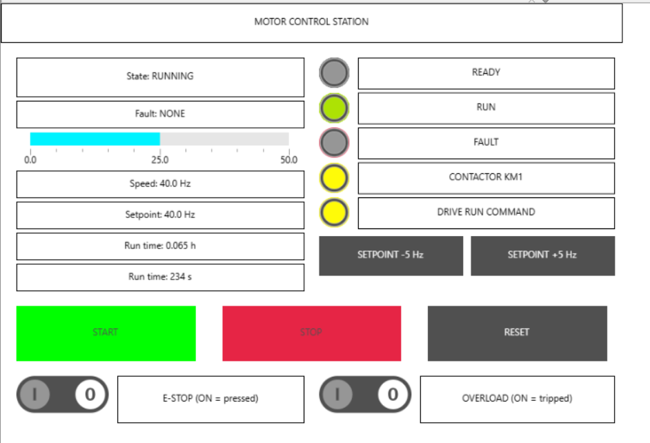
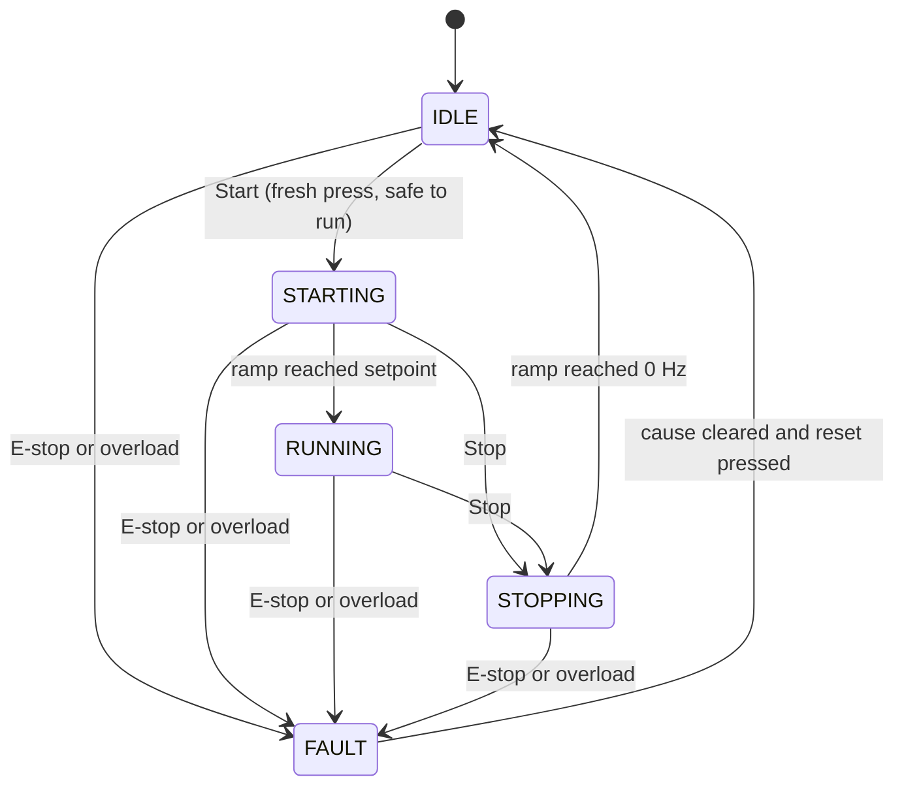
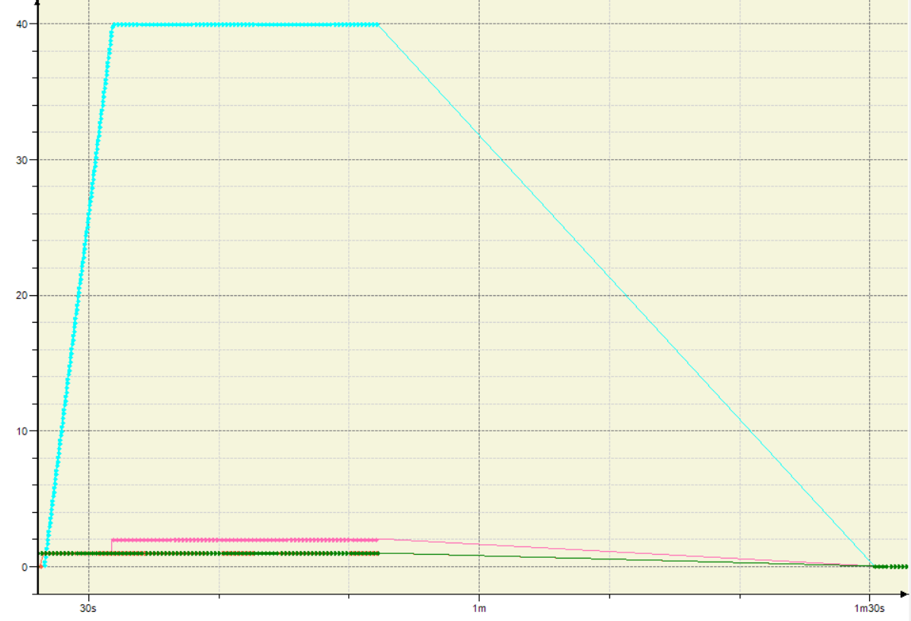
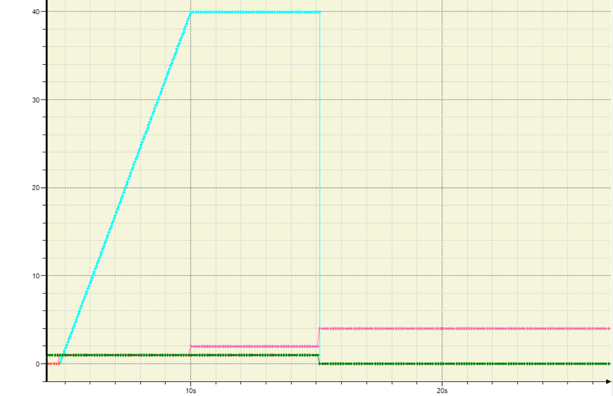

# codesys-motor-control-station
# Motor Control Station with Safety Interlocks and VFD Speed Reference

A motor starter with a speed-controlled drive, built the way a real station is:
latching start/stop, emergency stop, overload trip, latched faults with a guarded reset,
soft-start and soft-stop ramps, and a run-hour counter. Written in IEC 61131-3 Structured Text
for CODESYS V3 and tested on the CODESYS Control Win SoftPLC, with an operator HMI.



## Features

- Seal-in start/stop circuit. Stop always wins. Start is accepted only from IDLE and only on a fresh press, so a held Start button can never restart the motor after a fault reset.
- Fail-safe inputs: E-stop, Stop and overload are wired as normally-closed contacts, so a broken wire is treated as a stop or fault.
- Latched fault handling with an edge-triggered reset that is blocked while the cause is still present. E-stop has priority over overload in the fault code.
- Five-state machine: IDLE, STARTING, RUNNING, STOPPING, FAULT.
- Soft-start and soft-stop ramp (default 5 s each) producing a 0 to 50 Hz speed reference, with a smooth reversal if Stop is pressed mid-ramp and an immediate zero on any fault.
- Contactor first, then the drive run command after a 500 ms pull-in delay.
- Run-hour counter that includes the stop ramp, keeps its fractional second between runs, and survives resets and downloads (PERSISTENT RETAIN).
- Operator HMI with state, fault text, speed bar, setpoint buttons, lamps, and controls.
- Input simulator so the whole station can be tested without hardware.

## Architecture

Cyclic task `MainTask`, 10 ms, one program call chain:

```
PLC_PRG
 ├─ PRG_InputSim   merge simulator and HMI commands into the input variables
 ├─ PRG_Safety     E-stop / overload detection, fault latch, guarded reset, xSafeToRun
 ├─ PRG_Station    start/stop seal-in, state machine, contactor, drive run, lamps
 ├─ PRG_Ramp       FB_RampGenerator: speed reference in Hz
 ├─ PRG_RunHours   run-time counter
 └─ PRG_HMI        screen texts and setpoint buttons
```

Data is organized in enums (`E_StationState`, `E_FaultCode`), a configuration struct (`ST_Config`),
and global lists (`GVL_IO`, `GVL_Station`, `GVL_Sim`, `GVL_HMI`).

### State machine



### Ramp generator

The step per scan is `setpoint x scan time / ramp time`. For example, `40 Hz x 10 ms / 5 s = 0.08 Hz per scan`,
so the ramp takes exactly 500 scans (5 s). Stopping from the setpoint takes `tRampDown`, and stopping mid-ramp takes proportionally less.



## Inputs and outputs

| Signal | Type | Meaning |
|---|---|---|
| `iEStop_OK` | Input, NC | TRUE = healthy, FALSE = E-stop pressed or wire broken |
| `iStop_PB` | Input, NC | TRUE = released, FALSE = pressed |
| `iStart_PB` | Input, NO | TRUE = pressed |
| `iOverload_OK` | Input, NC | TRUE = healthy, FALSE = tripped |
| `iFaultReset_PB` | Input, NO | TRUE = pressed |
| `qContactor_KM1` | Output | Main contactor coil |
| `qDriveRun` | Output | Run command to the VFD |
| `qSpeedRef_Hz` | Output (REAL) | Speed reference to the VFD, 0 to 50 Hz |
| `qLamp_Ready`, `qLamp_Run`, `qLamp_Fault` | Outputs | Ready, running or ramping (blinks during ramps), fault |

## How to run it

1. Install CODESYS V3 and the CODESYS Control Win V3 x64 runtime, and start the runtime.
2. Download `MotorControlStation_v1.0.0.projectarchive` from the [latest release](https://github.com/YOUR-USERNAME/codesys-motor-control-station/releases/latest) and open it (File > Project Archive > Open).
3. Set the communication path to the local SoftPLC, then Build, Login and Start.
4. Open `Visu_Main` and operate the station with the mouse, or drive `GVL_Sim` from a watch window.

## Testing

The station was verified with 53 numbered test cases plus two extra checks (a 60 s stopwatch accuracy check for the run-hour counter and a persistence check across a download). Highlights:

| Requirement | Verified by |
|---|---|
| Start and stop latch, Stop wins, no auto-restart | Section 4 tests T4 to T12 |
| E-stop and overload fail safe in the same scan | Section 3 T1 to T9, Section 4 T10 and T13, Section 5 R8 |
| Guarded, edge-triggered fault reset | Section 3 T6 to T9 |
| Soft-start, soft-stop, mid-ramp reversal, setpoint limits | Section 5 R2 to R7 |
| Run-hour counter and retention | Section 6 checks, Section 7 S2, S3, S10 |
| HMI operation | Section 8 H1 to H12 |



## Limitations

- Input simulation only. No physical I/O or real VFD is connected, so the speed reference is a variable, not a field-bus or analog output.
- The safety logic here is standard PLC code. A real E-stop must be hard-wired or implemented on certified safety hardware, and the contacts in this project are simulated.
- Ramp and run-hour timing count scans and assume the task really runs at 10 ms.
- Overload reset has no cool-down delay, which a real thermal relay would need.

## Possible extensions

- Drive the VFD through Modbus or an analog output card on real hardware
- Alarm history with timestamps
- Retentive configuration (ramp times and setpoint) edited from the HMI
- Separate safety function on a certified safety PLC
- OPC UA export of status and run hours

## Author

Messaoudi Abderrahmane, M.Sc. electrical control engineer. Profile URL https://www.linkedin.com/in/abderrahmane-messaoudi-893370305
